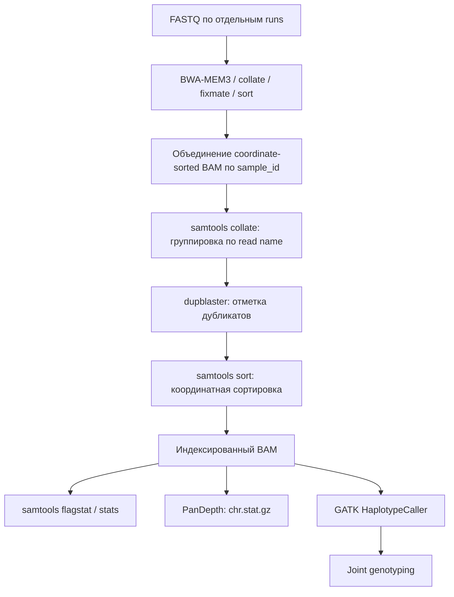

# Экспериментальная ветка `test`: PanDepth и DupBlaster

Ветка заменяет `mosdepth` на PanDepth 2.26 и `samtools markdup` на DupBlaster 0.1.1. Вызов вариантов, список референсов, SLURM-оркестрация и параметры образцов не меняются.

## Изменения в цепочке BAM



DupBlaster **нельзя** запускать непосредственно на объединённом BAM после coordinate sort. Он требует query-grouped records. Поэтому в тестовом варианте добавлены `samtools collate` перед DupBlaster и coordinate sort после него. Такой переход сохраняет корректное объединение нескольких sequencing runs и libraries, но добавляет операции I/O. Ускорение всей цепочки **не гарантировано**: измерять нужно полный этап markdup вместе с перегруппировкой и сортировкой, а не только работу dupblaster.

По умолчанию DupBlaster **помечает**, но не удаляет дубликаты. Включён `picard-exact` для unmated/orphan reads. Определение sequencing/optical duplicates по QNAME отключено: имена публичных SRA reads могут не соответствовать исходному Illumina layout. Маркировка PCR/library duplicates остаётся включённой. DupBlaster автоматически разделяет duplicate marking по `@RG LB`.

Для PanDepth результат: `<prefix>.chr.stat.gz` вместо `<prefix>.mosdepth.summary.txt`. Также сохраняются `samtools flagstat` и `samtools stats`. Изменено условие QC resume в `wgs.py`.

## Установка окружения на sphinx

```bash
# Установить окружение из envs/wgs-gatk-mem3-test.yaml.
# Рабочее окружение wgs-gatk-mem3 остаётся без изменений.
conda env create -f envs/wgs-gatk-mem3-test.yaml
conda env create -f envs/pandepth-test.yaml
conda activate wgs-gatk-mem3-test
# Добавляем только бинарник PanDepth; samtools/bcftools остаются из основной среды.
export PATH="$(dirname "$CONDA_PREFIX")/minsnp-pandepth/bin:$PATH"

command -v pandepth
command -v dupblaster
samtools --version | head -1
bcftools --version | head -1
pandepth -h
dupblaster --version
python pipeline.py --check-tools
```

Важно: Bioconda PanDepth=2.26 требует HTSlib 1.23.x, тогда как samtools/bcftools=1.24 используют более новую HTSlib. Поэтому PanDepth запускается как отдельный исполняемый файл из соседнего Conda-окружения; его собственные разделяемые библиотеки должны корректно находиться через RPATH. Проверьте запуск `pandepth -h` в окружении на `sphinx` до отправки SLURM jobs. `sbatch` должен наследовать `PATH` с этим каталогом.

Для контейнерного теста используйте `docker build -f Dockerfile.test -t minsnp:test .` (при наличии Docker). Референсы и FASTQ нужно монтировать отдельно.

## Проверка и запуск

```bash
PYTHONPATH=src python -m pytest -q
for script in stages/*.sh; do bash -n "$script" || exit 1; done

# План без отправки заданий
python pipeline.py --fastq inputs/beluga_two.fastq.tsv inputs/polar_bear_two.fastq.tsv \
  --backend slurm --run-id tool_swap_test_01

# После проверки плана и окружения — отправка
python pipeline.py --fastq inputs/beluga_two.fastq.tsv inputs/polar_bear_two.fastq.tsv \
  --backend slurm --run-id tool_swap_test_01 --submit
```

**Используйте новый `run-id`.** Не пытайтесь повторно использовать BAM, gVCF или результаты QC из ветки `develop` посредством `--resume`: код и критерии QC изменились.

## Что сравнивать с `develop`

1. Время и RSS **всей** стадии markdup (включая повторную collate и sort), всей QC-стадии и полного FASTQ → VCF.
2. Число `0x400` reads и duplicate fraction; различия в выборе representative reads допустимы, но требуют проверки групп дубликатов.
3. Глубину и процент покрытых позиций с одинаковым фильтром SAM flags, MAPQ и определением denominator; численные значения PanDepth и mosdepth могут различаться при разных параметрах.
4. Количество SNP, распределение DP/GQ, missingness и сопоставимость генотипов в итоговых VCF на одинаковой выборке.
5. Объём промежуточных BAM и нагрузку на хранилище.

Для первого сравнения разумно использовать **два независимых `run-id`** и одинаковые FASTQ, reference, CPU/RAM, узел и параметры variant calling. Временная статистика SLURM зависит также от ожидания диска и загрузки узла.

Источники: [PanDepth](https://github.com/HuiyangYu/PanDepth), [DupBlaster](https://github.com/fulcrumgenomics/dupblaster).
