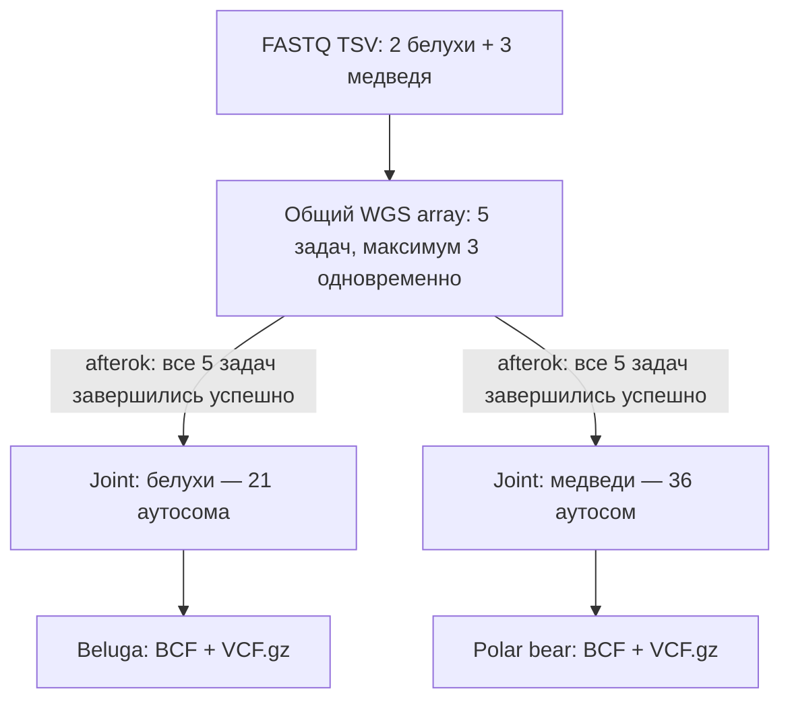

# Minimal SNP Panels — техническое руководство

**Архитектура от 2 ноября 2026 года.** Основной рабочий сценарий — FASTQ → multi-sample VCF/BCF. Анализ популяционной структуры и отбор SNP-панелей пока не подключены.

## 1. Что делает pipeline

Проект обрабатывает данные полногеномного секвенирования (WGS) белух (*Delphinapterus leucas*) и белых медведей (*Ursus maritimus*). Он подготавливает генотипы для последующего анализа популяционной структуры и разработки минимальных SNP-панелей, позволяющих различать генетические популяции.

У pipeline три сценария:

| Вход | Задача | Состояние |
|---|---|---|
| FASTQ-манифесты | Картирование, обработка BAM, вызов вариантов и совместное генотипирование | Реализован; требуется end-to-end проверка на `sphinx` |
| Индексированный VCF/BCF | Определение популяционной структуры и подготовка `population_labels.tsv` | Заглушка |
| Индексированный VCF/BCF + population labels | Отбор и проверка минимальной SNP-панели | Заглушка |

Заглушки проверяют входы и сообщают, что анализ не реализован. Они не создают искусственные метки, SNP-панели или метрики. Старые модули `qc.py`, `structure.py` и `panels.py` сохранены, но не входят в основной пользовательский workflow.

Основной интерфейс для будущего анализа — **индексированный multi-sample VCF/BCF и отдельная таблица популяционных меток**. Способ получения меток не должен влиять на работу модуля отбора SNP.

## 2. Как данные проходят через pipeline

```text
Парные FASTQ.gz, одна или несколько пар файлов на животное
    → fastp (если включён)
    → BWA-MEM3 → samtools collate → fixmate → sort
    → отдельный BAM для каждой строки FASTQ-манифеста
    → объединение BAM одного животного → markdup → BAM + BAI
    → BAM QC (samtools, mosdepth)
    → HaplotypeCaller -ERC GVCF по всем аутосомам
    → gVCF-манифест животного
    → GenomicsDBImport → GenotypeGVCFs по аутосомам внутри вида
    → bcftools concat → cohort.raw.bcf + индекс
    → bcftools view → cohort.raw.vcf.gz + индекс
```

### Как группируются lanes и sequencing runs

Каждая строка FASTQ-манифеста описывает одну пару FASTQ. Pipeline отдельно картирует эти пары, а затем **объединяет BAM по `species` и `sample_id`**. Он не определяет принадлежность к животному по имени файла или по суффиксам `L001` и `L002`.

`run_id` и `library` нужны для различения входных единиц и формирования read groups. Сочетание `(sample_id, run_id, library)` должно быть уникальным. Если у одного животного несколько lanes, в таблице должны быть отдельные строки с уникальными идентификаторами входных единиц; отдельного столбца `lane` в текущем формате нет.

После объединения BAM программа маркирует дубликаты и вызывает HaplotypeCaller для каждого ожидаемого аутосомного интервала животного. Вызовы по аутосомам выполняются последовательно, внутри одного задания.

### Зачем нужны gVCF и joint genotyping

HaplotypeCaller в режиме `-ERC GVCF` записывает не только обнаруженные варианты, но и сведения о генотипической неопределённости и референсных участках. `GenotypeGVCFs` использует gVCF всех животных одного вида для согласованного определения генотипов.

Pipeline **не объединяет индивидуальные variant-only VCF**. Сначала он выполняет совместное генотипирование каждого аутосомного интервала, затем `bcftools concat` собирает хромосомы с одинаковым составом образцов в один BCF.

Для белух используется референс `GCA_059928025.1` (21 аутосома), для белых медведей — `GCA_062004589.1` (36 аутосом). Пути к FASTA и список contigs задаются в `config/references.yaml`. Совместное генотипирование разных видов в одном BCF не допускается.

## 3. Как запускаются задания SLURM

Pipeline формирует **один общий WGS array для всех животных текущего запуска**, независимо от вида. Один элемент массива обрабатывает одно животное от FASTQ до полного набора gVCF; аутосомы не отправляются в SLURM отдельно.

После успешного завершения **всего WGS array** pipeline отправляет по одному joint-заданию для каждого вида. Зависимость `afterok` не позволяет автоматически начать joint, если хотя бы одно животное завершилось с ошибкой. Внутри каждого joint-задания аутосомы также обрабатываются последовательно.



Для пяти животных двух видов это **три вызова `sbatch`**: один WGS array и два joint jobs. Элементы массива — отдельные вычислительные задачи, хотя массив отправляется одним вызовом.

`max_parallel_samples` ограничивает число одновременно работающих животных **в этом массиве**, а не во всех независимых запусках пользователя.

## 4. Как задаются и рассчитываются ресурсы

`config/pipeline.yaml` хранит CPU, RAM и время для целого WGS-задания (`sample`) и для joint-задания одного вида (`joint`):

```yaml
slurm:
  partition: main
  nodelist: meduza-1
  max_parallel_samples: 3
  sample:
    cpus: 16
    memory: 64G
    time: "2-00:00:00"
  joint:
    cpus: 8
    memory: 48G
    time: "2-00:00:00"
```

Внутри одного задания стадии идут последовательно и используют общий выделенный бюджет. SLURM не перераспределяет CPU и RAM между `align.sh`, `markdup.sh` и HaplotypeCaller. `sample.time` — предел времени на **одно животное**, `joint.time` — на **один вид**, включая последовательную обработку всех его аутосом.

Для одинаковых WGS-заданий максимальный одновременный запрос вычисляется так:

```text
N_running = min(N_samples, max_parallel_samples)
CPU_WGS  = N_running × sample.cpus
RAM_WGS  = N_running × sample.memory
```

**Пример.** При двух белухах, трёх медведях и `max_parallel_samples: 3` одновременно выполняются не более трёх WGS-заданий. Если каждое запрашивает 16 CPU и 64 GiB, суммарный максимум — **48 CPU и 192 GiB RAM**.

После окончания WGS два joint-задания могут работать одновременно. При 8 CPU и 48 GiB на вид их совместный запрос — **16 CPU и 96 GiB RAM**. WGS и joint в этой схеме не перекрываются, поэтому пики не складываются.

Это расчёт **запрошенных**, а не фактически использованных ресурсов. SLURM может оставить часть задач в `PENDING`, если на узле нет свободных ресурсов. Внутри одной стадии могут одновременно работать BWA-MEM3 и samtools, поэтому их совокупное потребление должно укладываться в бюджет задания.

## 5. Как запустить анализ

Активируйте окружение и проверьте CLI:

```bash
conda activate wgs-gatk-mem3
python pipeline.py --help
```

### Проверить план без отправки заданий

```bash
python pipeline.py \
  --fastq inputs/beluga_two.fastq.tsv inputs/polar_bear_two.fastq.tsv \
  --backend slurm --run-id mixed_test_001
```

Команда проверяет входные файлы и настройки, готовит план и выводит расчёт ресурсов. **Вычислительные задания не отправляются.**

### Отправить задания

```bash
python pipeline.py \
  --fastq inputs/beluga_two.fastq.tsv inputs/polar_bear_two.fastq.tsv \
  --backend slurm --run-id mixed_test_001 --submit
```

### Проверить статус

```bash
python pipeline.py status --run-id mixed_test_001
squeue -r -u "$USER"
```

Отсутствие задания в `squeue` не означает успешного завершения. Нужно проверить логи, состав образцов и целостность итогового VCF/BCF.

### Запустить без SLURM

```bash
python pipeline.py \
  --fastq inputs/beluga_two.fastq.tsv \
  --backend local --run-id beluga_local_001
```

Локальный режим сразу начинает вычисления. Для повторного запуска используйте `--resume` с неизменными входами, конфигурацией и версией кода. Если меняется состав когорты или программная реализация, задайте новый `--run-id`.

Downstream-интерфейсы пока не реализованы:

```bash
python pipeline.py --vcf /path/to/cohort.raw.bcf

python pipeline.py --vcf /path/to/cohort.raw.bcf \
  --labels /path/to/population_labels.tsv
```

## 6. Формат входной таблицы

Каждый FASTQ-манифест — TSV с шестью обязательными столбцами:

```text
sample_id  species  run_id  library  fastq_r1  fastq_r2
```

| Поле | Значение |
|---|---|
| `sample_id` | Уникальный идентификатор животного |
| `species` | `beluga` или `polar_bear` |
| `run_id` | Идентификатор входной единицы секвенирования |
| `library` | Библиотека, используемая в read group |
| `fastq_r1`, `fastq_r2` | Пути к парным FASTQ |

Относительные пути к FASTQ отсчитываются от каталога TSV. Один `sample_id` не может принадлежать двум видам. Повторять сочетание `(sample_id, run_id, library)` или использовать один и тот же FASTQ в нескольких строках нельзя.

**Пример группировки:** если для `BEL_001` указаны две строки с разными `run_id`, pipeline построит два промежуточных BAM и объединит их в один BAM животного. Строка `BEL_002` не войдёт в это объединение, даже если имена исходных файлов похожи.

## 7. Где находятся результаты и как работает возобновление

```text
results/<run-id>/
├── slurm_plan.json
├── versions.json
├── slurm_jobs.json
├── manifests/<species>/<sample>.tsv
├── samples/<species>/<sample>/
│   └── wgs/
│       ├── lanes/
│       ├── bam/
│       ├── qc/
│       └── gvcf/
└── joint/<species>/
    ├── genomicsdb/
    ├── per_contig/
    ├── cohort.raw.bcf
    ├── cohort.raw.bcf.csi
    ├── cohort.raw.vcf.gz
    └── cohort.raw.vcf.gz.csi
```

`slurm_plan.json` фиксирует когорту и параметры запуска. Для входных TSV, конфигурации и кода используются контрольные суммы; для больших FASTQ сохраняются метаданные файлов, включая размер и время изменения, без полного повторного хеширования. `slurm_jobs.json` и промежуточная запись `slurm_jobs.partial.json` помогают избежать случайной повторной отправки заданий.

При `--resume` pipeline должен повторно использовать только проверенные результаты: BAM, проходящие `samtools quickcheck`; индексированные и читаемые gVCF; BCF/VCF с ожидаемым составом образцов. Неизвестную неполную GenomicsDB нельзя считать готовой.

**Ограничения текущей версии:** механизмы защиты от конкурирующих записей в один `run-id`, восстановления неполного экспорта VCF и контроля содержимого FASTA требуют отдельного исправления. Поэтому не запускайте локальные и SLURM-вычисления одновременно в один каталог, а перед `--resume` проверяйте состояние предыдущих заданий и результатов.

## 8. Что проверяется и чего эти проверки не гарантируют

Pipeline контролирует входные FASTQ и их повторное использование, проверяет BAM с помощью `samtools`, рассчитывает статистики `flagstat`, `stats` и `mosdepth`, а также проверяет читаемость gVCF/BCF, индексы, ожидаемые аутосомы и состав образцов.

Этого недостаточно для популяционно-генетического анализа. Отдельно потребуются фильтрация вариантов и образцов, оценка missingness, покрытия, гетерозиготности, LD и возможных batch-эффектов. Для low-coverage WGS потребуется оценить неопределённость генотипов и применимость методов на основе genotype likelihoods или иммутации.

Генетические кластеры не обязательно совпадают с географически определёнными популяциями. При проверке SNP-панелей отбор признаков, LD filtering и подбор параметров классификатора должны выполняться **внутри обучающих folds**, чтобы избежать data leakage.

## 9. Как проверить новую версию перед масштабированием

```bash
PYTHONPATH=src python -m pytest -q

for script in stages/*.sh; do
    bash -n "$script" || exit 1
done

python pipeline.py --help
```

После модульных проверок выполните end-to-end запуск на небольшой когорте. Проверьте успешность SLURM jobs, логи BWA-MEM3/GATK, полноту gVCF, наличие всех ожидаемых аутосом, состав образцов в BCF/VCF, время работы, нагрузку на память и объём временных файлов.

Исторический пилот `pilot_20261030` использовал предыдущую реализацию. Его результаты нельзя считать end-to-end проверкой нового Python CLI. Для испытаний новой версии используйте отдельный `run-id`.

## 10. Что будет следующим этапом

После проверки FASTQ → VCF начинается отдельный анализ: QC вариантов и животных → LD pruning → PCA и оценка структуры → проверенные `population_labels.tsv`.

Затем ветка VCF + labels будет рассчитывать частоты аллелей и FST, ранжировать SNP, формировать панели разных размеров и сравнивать их качество с помощью cross-validation. Цель — выбрать минимальную панель по заранее заданной метрике, не допуская утечки данных между обучением и проверкой.

Методические решения и опубликованные результаты собираются в `literature/literature_methods.tsv`.