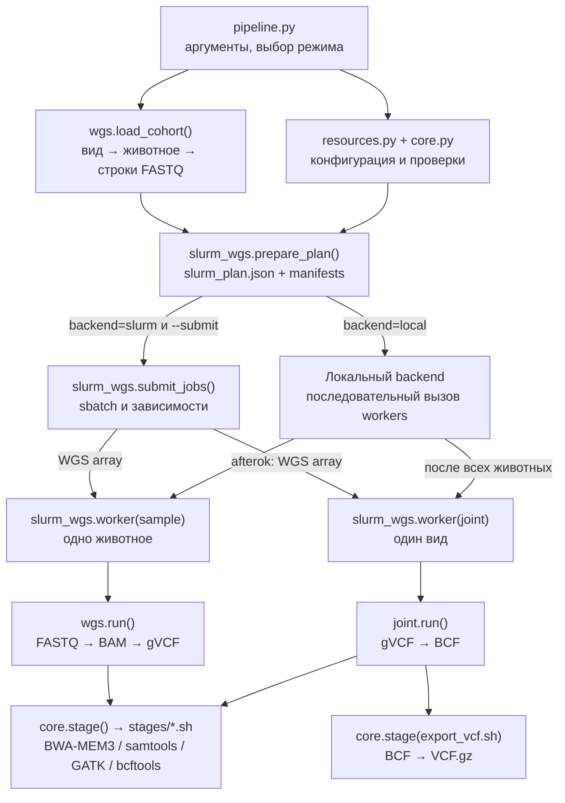
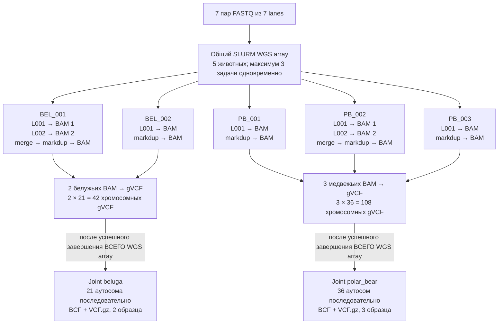

# Python-модули Minimal SNP Panels (`src/minsnp`)

Этот каталог содержит Python-код, который организует обработку WGS: проверяет входные данные, готовит вычислительный план, запускает Bash-стадии, собирает gVCF и выполняет совместное генотипирование. Само картирование и вызов вариантов выполняют BWA-MEM3, samtools, GATK и bcftools через скрипты `stages/*.sh`.

**Точка входа находится в корне репозитория — `pipeline.py`.** Файлы внутри `src/minsnp/` не нужно запускать вручную. В текущей версии рабочий сценарий — FASTQ → BAM → gVCF → multi-sample BCF/VCF.gz. Популяционная структура и отбор SNP-панелей ещё не подключены.

## Как связаны модули

| Файл | Ответственность | Кто его вызывает |
| --- | --- | --- |
| `core.py` | Чтение и запись TSV, проверка референса, вызов Bash-стадий и логирование, проверка индексов, версии инструментов | `pipeline.py`, `wgs.py`, `joint.py`, `slurm_wgs.py` |
| `resources.py` | Проверка `config/pipeline.yaml`, бюджеты CPU/RAM для `sample` и `joint`, проверка SLURM-аллокации | `pipeline.py`, `core.py`, `slurm_wgs.py`, `wgs.py` |
| `wgs.py` | Проверка FASTQ-манифестов, группировка строк по виду и животному, BAM, QC и индивидуальные gVCF | `pipeline.py` (загрузка когорты), `slurm_wgs.py` (обработка животного) |
| `joint.py` | Проверка gVCF всех животных вида, GenomicsDBImport, GenotypeGVCFs и сборка многосэмплового BCF | `slurm_wgs.py` |
| `slurm_wgs.py` | План запуска, общий WGS array, зависимости joint-заданий, workers и команда `status` | `pipeline.py` |
| `analysis_stub.py` | Проверка входных VCF/BCF для двух будущих сценариев; сообщает, что реализация отсутствует | `pipeline.py` |
| `__init__.py` | Обозначает `minsnp` как Python-пакет | Python |

Файлы `qc.py`, `structure.py`, `panels.py` и `reporting.py` сохранены в каталоге, но **не участвуют в текущем сценарии FASTQ → VCF**. `cli.py` также не является пользовательской точкой входа: CLI находится в корневом `pipeline.py`.

### Схема вызовов



В режиме `--backend slurm` **без `--submit`** вызываются только проверки TSV/ресурсов и расчёт запросов. План на диске и SLURM-задания при таком dry-run не создаются.

## Какие данные передаются между модулями

1. **FASTQ TSV → `wgs.load_cohort()`**: словарь вида `species → sample_id → список строк FASTQ`. Один `sample_id` может содержать несколько строк. В одной когорте могут присутствовать оба вида.
2. **Когорта → `slurm_wgs.prepare_plan()`**: создаются `slurm_plan.json` и отдельный TSV для каждого животного. План содержит идентификаторы животных, пути манифестов, сведения о входных файлах и контрольные суммы конфигурации и кода.
3. **План → `slurm_wgs.worker(group="sample")`**: worker по индексу array выбирает животное и вызывает `wgs.run()` с его TSV и референсом.
4. **`wgs.run()` → `gvcf_manifest.tsv`**: для каждого животного формируется таблица `sample_id`, `contig`, `gvcf_path` — одна строка на ожидаемую аутосому.
5. **gVCF всех животных одного вида → `joint.py`**: `slurm_wgs.py` собирает общий `cohort_gvcf.tsv`; `joint.validate_gvcf()` проверяет полноту матрицы «животное × аутосома».
6. **`joint.run()` → `cohort.raw.bcf`**: GenomicsDBImport и GenotypeGVCFs запускаются последовательно для каждой аутосомы; `concat.sh` объединяет хромосомные VCF. После этого `export_vcf.sh` создаёт `cohort.raw.vcf.gz`.

**GVCF — не независимый окончательный набор SNP каждого животного.** HaplotypeCaller сохраняет информацию, необходимую для последующего совместного определения генотипов. На этапе joint формируются общие позиции и генотипы образцов данного вида.

## Пример: 5 животных, 2 вида, 7 lanes

Предположим, у нас две белухи (`BEL_001`, `BEL_002`) и три белых медведя (`PB_001`, `PB_002`, `PB_003`). Белуха `BEL_001` и медведь `PB_002` секвенированы **каждый на двух lanes**. Остальные три животных имеют по одной lane.

| Животное | Вид | Библиотека | Lanes | Строк в FASTQ TSV |
| --- | --- | --- | --- | ---: |
| `BEL_001` | `beluga` | `LIB_B01` | L001, L002 | 2 |
| `BEL_002` | `beluga` | `LIB_B02` | L001 | 1 |
| `PB_001` | `polar_bear` | `LIB_P01` | L001 | 1 |
| `PB_002` | `polar_bear` | `LIB_P02` | L001, L002 | 2 |
| `PB_003` | `polar_bear` | `LIB_P03` | L001 | 1 |
| **Итого** | **2 вида** | **5 библиотек** | **7 lanes** | **7** |

### Пример входного TSV

Это **иллюстративные идентификаторы и пути**, а не существующие FASTQ. Пути в примере отсчитываются от каталога `inputs/`, где предполагается разместить файл `example_5_samples.tsv`.

```tsv
sample_id	species	run_id	library	fastq_r1	fastq_r2
BEL_001	beluga	B01_L001	LIB_B01	../data/wgs/EXAMPLE/BEL_001_L001_R1.fastq.gz	../data/wgs/EXAMPLE/BEL_001_L001_R2.fastq.gz
BEL_001	beluga	B01_L002	LIB_B01	../data/wgs/EXAMPLE/BEL_001_L002_R1.fastq.gz	../data/wgs/EXAMPLE/BEL_001_L002_R2.fastq.gz
BEL_002	beluga	B02_L001	LIB_B02	../data/wgs/EXAMPLE/BEL_002_L001_R1.fastq.gz	../data/wgs/EXAMPLE/BEL_002_L001_R2.fastq.gz
PB_001	polar_bear	P01_L001	LIB_P01	../data/wgs/EXAMPLE/PB_001_L001_R1.fastq.gz	../data/wgs/EXAMPLE/PB_001_L001_R2.fastq.gz
PB_002	polar_bear	P02_L001	LIB_P02	../data/wgs/EXAMPLE/PB_002_L001_R1.fastq.gz	../data/wgs/EXAMPLE/PB_002_L001_R2.fastq.gz
PB_002	polar_bear	P02_L002	LIB_P02	../data/wgs/EXAMPLE/PB_002_L002_R1.fastq.gz	../data/wgs/EXAMPLE/PB_002_L002_R2.fastq.gz
PB_003	polar_bear	P03_L001	LIB_P03	../data/wgs/EXAMPLE/PB_003_L001_R1.fastq.gz	../data/wgs/EXAMPLE/PB_003_L001_R2.fastq.gz
```

**Особенность текущего формата:** отдельного столбца `lane` нет. Комбинация `(sample_id, run_id, library)` должна быть уникальной. Поэтому в этом примере идентификатор `run_id` включает суффикс lane (`B01_L001`, `B01_L002`). Это **технический идентификатор строки**, а не обязательно исходный SRA accession или номер физического sequencing run. Если нужно независимо хранить настоящий run accession и lane, потребуется расширить схему TSV и read group — нынешний формат этого не делает. Идентификатор `library` для двух lanes одной библиотеки остаётся одинаковым.

### Что произойдёт при запуске

```bash
python pipeline.py \
  --fastq inputs/example_5_samples.tsv \
  --backend slurm --run-id example_five_001

# После проверки плана и замены примеров реальными FASTQ:
python pipeline.py \
  --fastq inputs/example_5_samples.tsv \
  --backend slurm --run-id example_five_001 --submit
```

При `max_parallel_samples: 3` создаётся **один WGS array из пяти задач (`--array=0-4%3`)**, а не отдельные массивы для каждого вида. Очерёдность животных определяется индексами плана и расписанием SLURM; одновременно работает не более трёх задач этого массива.



Формально оба joint-задания зависят от **успешного завершения всего WGS array**, а не только животных своего вида (`afterok`). Поэтому, если WGS одного медведя завершится с ошибкой, joint белух тоже не начнётся автоматически.

Для каждого животного независимо выполняются:

```text
FASTQ каждой lane
  └─ [опционально trim.sh] → align.sh
       └─ отдельный coordinate-sorted BAM с read group
  └─ merge_bam.sh (несколько BAM → merge; один BAM → symlink)
       └─ markdup.sh → окончательный BAM + BAI
            ├─ bam_qc.sh → flagstat, stats, mosdepth
            └─ haplotypecaller.sh (-ERC GVCF)
                 └─ по одной аутосоме, последовательно
```

Следовательно, при пяти животных будут получены **7 первичных BAM по lanes, 5 итоговых BAM, 150 хромосомных gVCF и 2 многосэмпловых VCF/BCF** — при условии успешного выполнения всех стадий. Для одного входного BAM `merge_bam.sh` создаёт символическую ссылку вместо физического слияния.

## Ресурсы и параллелизм

В `config/pipeline.yaml` задаются общие бюджеты на WGS одного животного и joint одного вида:

```yaml
slurm:
  max_parallel_samples: 3
  sample:
    cpus: 16
    memory: 64G
    time: "2-00:00:00"
  joint:
    cpus: 8
    memory: 48G
    time: "2-00:00:00"
```

Все Bash-стадии одного WGS-задания последовательно используют бюджет `sample`; все операции joint одного вида — бюджет `joint`. Python через `core.stage()` передаёт дочерним процессам `MIN_SNP_THREADS` и `MIN_SNP_MEMORY_MB`. Bash-скрипты распределяют потоки между своими программами и задают память Java heap с запасом для остальных процессов.

| Этап | Одновременных заданий в примере | CPU на задание | RAM на задание | Максимальный одновременный запрос |
| --- | ---: | ---: | ---: | --- |
| WGS | 3 из 5 | 16 | 64 GiB | **48 CPU, 192 GiB** |
| Joint | 2 вида | 8 | 48 GiB | **16 CPU, 96 GiB** |

WGS и joint не перекрываются благодаря `afterok`, поэтому эти максимумы не суммируются. Память и CPU — **запросы к SLURM**, а не измеренное потребление. Лимит `%3` действует на этот array, но не ограничивает другие независимые запуски пользователя.

## Где искать результаты

```text
results/example_five_001/
├── slurm_plan.json                 # Состав когорты и контрольные суммы
├── versions.json                   # Версии внешних инструментов
├── slurm_jobs.json                 # ID отправленных заданий
├── manifests/
│   ├── beluga/
│   │   ├── BEL_001.tsv             # Две строки: L001 и L002
│   │   ├── BEL_002.tsv
│   │   └── cohort_gvcf.tsv         # 42 строки
│   └── polar_bear/
│       ├── PB_001.tsv
│       ├── PB_002.tsv              # Две строки: L001 и L002
│       ├── PB_003.tsv
│       └── cohort_gvcf.tsv         # 108 строк
├── samples/
│   ├── beluga/BEL_001/
│   │   ├── wgs/lanes/BEL_001/      # BAM L001 и L002
│   │   ├── wgs/bam/                # BEL_001.merged.bam; BEL_001.bam (+ BAI)
│   │   ├── wgs/qc/
│   │   ├── wgs/gvcf/BEL_001/       # 21 gVCF (+ индексы)
│   │   ├── wgs/gvcf_manifest.tsv
│   │   └── logs/
│   ├── beluga/BEL_002/...
│   ├── polar_bear/PB_001/...
│   ├── polar_bear/PB_002/...
│   └── polar_bear/PB_003/...
├── joint/
│   ├── beluga/
│   │   ├── genomicsdb/             # По аутосоме
│   │   ├── per_contig/             # Хромосомные VCF
│   │   ├── cohort.raw.bcf          # 2 образца
│   │   └── cohort.raw.vcf.gz       # 2 образца
│   └── polar_bear/
│       ├── cohort.raw.bcf          # 3 образца
│       └── cohort.raw.vcf.gz       # 3 образца
└── logs/                           # Логи SLURM и joint
```

Итоговые BCF и `VCF.gz` индексируются (`.csi`). Дополнительные внутренние файлы включают `cohort.lock.json`, sample maps и журналы Bash-стадий.

## Ошибки, повторный запуск и ограничения

- `core.stage()` запускает Bash-скрипт, пишет лог и при ненулевом коде завершения выбрасывает ошибку. Ошибка WGS-задачи не позволяет зависимым joint-заданиям стартовать через `afterok`.
- `--resume` требует прежнего `run-id` и совместимого сохранённого плана. Уже имеющиеся BAM/gVCF проверяются и часть стадий может быть пропущена. Прерванное **создание самого плана** восстанавливается при `--resume` (после применения targeted fixes).
- `status` показывает состояние SLURM и наличие части результатов, но **не является полноценным QC** итогового файла.
- В текущей версии остаются ограничения, выявленные аудитом: например, экспортированный VCF без индекса не пересоздаётся автоматически; содержимое FASTA не хешируется при фиксации плана. Не следует считать любой `--resume` полностью безопасным для всех видов сбоев.
- Пример с lanes иллюстрирует существующий формат входных данных, **не добавляет поддержку отдельного поля `lane`**.

Для пользовательских команд см. [главный README](../../README.md), для конфигурации и внутренней архитектуры — [PROJECT_GUIDE.md](../../docs/PROJECT_GUIDE.md).
